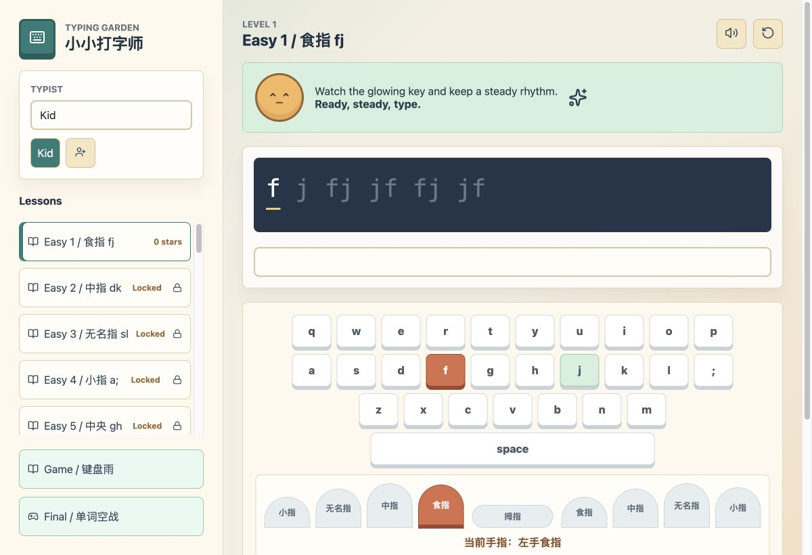

# 小小打字师 / Typing Garden

<p align="center">
  
</p>

<p align="center">
  面向儿童的 macOS 离线打字练习软件。
</p>

<p align="center">
  <a href="README.md">English</a> |
  <a href="README.zh-CN.md">简体中文</a> |
  <a href="https://github.com/wanqingcn/typing-garden/releases">下载</a> |
  <a href="PRIVACY.md">隐私说明</a>
</p>

[](https://github.com/wanqingcn/typing-garden/actions/workflows/ci.yml)
[](LICENSE)
[](https://github.com/wanqingcn/typing-garden/releases)



Typing Garden 通过短小、渐进的课程帮助孩子熟悉键盘。应用包含键位练习、
英文单词和短句、中文拼音、手指引导、进度记录，以及两种打字游戏。软件完全
在本机运行，不需要账号，不包含广告、遥测或云端存储。

## 下载

打开 [最新版本](https://github.com/wanqingcn/typing-garden/releases/latest)，
根据 Mac 处理器选择安装包：

| Mac 类型 | 安装包 |
| --- | --- |
| Apple Silicon，包括 M1、M2、M3 及后续型号 | `Typing-Garden-<version>-arm64.dmg` |
| Intel | `Typing-Garden-<version>-x64.dmg` |

Typing Garden 需要 macOS 12 或更高版本。

## 安装

1. 从 GitHub Releases 下载对应的 DMG。
2. 打开 DMG，将 Typing Garden 拖入“应用程序”目录。
3. 从“应用程序”中打开 Typing Garden。

正式发布包会使用 Developer ID 签名并通过 Apple 公证。除非能够核对来源和
校验值，否则不要使用第三方镜像提供的安装包。

## 功能

| 范围 | 已包含 |
| --- | --- |
| 课程 | 32 个渐进式键位、单词、短句、拼音、数字、Shift 和符号课程 |
| 引导 | 彩色键盘、下一按键高亮和手指提示 |
| 反馈 | WPM、正确率、错字数、进度、星级和错字回放 |
| 游戏 | 键盘雨和单词空战 |
| 档案 | 多个本地儿童档案，分别保存练习进度 |
| 可访问性 | 支持实体键盘、可点击虚拟键盘和键盘可访问控件 |
| 声音 | 可关闭的本地打字音效，以及游戏单词的系统朗读 |

## 隐私

- 不需要账号或登录。
- 不包含广告、追踪、遥测或远程分析。
- 不上传云端，不提供在线排行榜。
- 档案名称和练习进度只保存在本机应用数据中。
- 不自动检查更新，也不运行后台网络服务。

可以在应用内删除单个档案。如需清除全部数据，请先退出应用，再删除
`~/Library/Application Support/Typing Garden/`。完整说明见
[PRIVACY.md](PRIVACY.md)。

## 本地开发

环境要求：

- Web 开发可使用 macOS、Linux 或 Windows
- macOS 应用打包必须在 Mac 上完成
- Node.js 22 和 npm

```bash
git clone https://github.com/wanqingcn/typing-garden.git
cd typing-garden
npm ci
npm test
npm run dev
```

构建前端：

```bash
npm run build
```

在 macOS 上生成未签名的 Apple Silicon 和 Intel 开发安装包：

```bash
npm run build:mac
```

维护者发布签名、公证版本时，应遵循
[docs/RELEASING.md](docs/RELEASING.md)。

## 项目结构

- `src/domain/`：经过测试的打字、档案、声音和游戏逻辑
- `src/data/`：课程和词汇数据
- `src/App.tsx`：应用状态和界面
- `electron/main.cjs`：macOS 窗口与安全策略
- `scripts/`：本地构建和发行脚本

## 参与贡献

欢迎提交问题和范围明确的 Pull Request。开始前请阅读
[CONTRIBUTING.md](CONTRIBUTING.md)。安全问题请按照
[SECURITY.md](SECURITY.md) 中的私密渠道报告。

## 许可证

Copyright (C) 2026 wanqingcn。

Typing Garden 是按照 [GNU GPL version 3 only](LICENSE) 发布的自由软件。
分发应用或修改版本时，必须遵守 GPL 对源码和声明的要求。第三方组件继续使用
各自原有许可证，详见 [THIRD_PARTY_NOTICES.md](THIRD_PARTY_NOTICES.md)。
